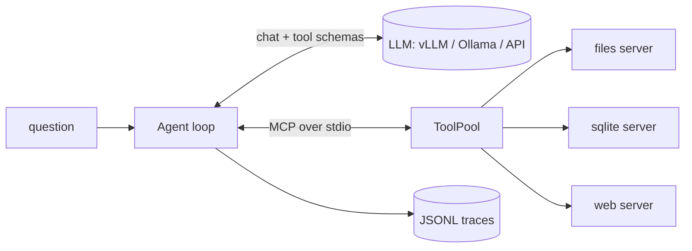

# Conduit

[](https://github.com/alleyxd/Conduit/actions/workflows/tests.yml)

A small, inspectable agent that answers questions using any OpenAI-compatible model and any
[MCP](https://modelcontextprotocol.io) tool server. It runs fully locally (tested with Qwen3-8B on vLLM on one
RTX 5090) and ships with an evaluation suite, so changes to prompts, tools or models can be measured
instead of guessed.

## What it does

Ask a question in plain English. The agent decides which tools to call, reads the results, retries when a
tool reports an error, and answers with facts it actually looked up.

```
$ conduit "If I buy two Camp Stoves, does my order ship free?" --think
  step 1: model wants files__search (2.74s)
    files__search({"text": "shipping free"}) -> ok: '(empty result: nothing matched)'
  step 2: model wants files__search (2.51s)
    files__search({"text": "shipping free"}) -> ok: '(empty result: nothing matched)'
  step 3: model wants files__list_files (2.3s)
    files__list_files({"folder": "shipping"}) -> error: "'shipping' does not exist; paths are relative to ..."
  step 4: model wants files__list_files (1.88s)
    files__list_files({"folder": "."}) -> ok: 'faq/stoves.md
loyalty.md
returns.md
shipping.md'
  step 5: model wants files__read_file (1.39s)
    files__read_file({"path": "shipping.md"}) -> ok: '# Shipping policy ... Orders over $150 (before tax) ship free ...'
  step 6: model wants files__read_file (5.33s)
    files__read_file({"path": "faq/stoves.md"}) -> ok: '# Camp Stove FAQ ...'

The shipping policy states that orders over $150 (before tax) ship free in Canada. However, the price
per Camp Stove is not provided in the available documents. ...
[7 steps, 6 tool calls, 8877 tokens, 19.62s]
```

A real, unedited run. It shows the parts that matter: an empty search, a wrong path that comes back as a
readable error, recovery by listing and reading the files, and an honest "I could not find the price" instead
of an invented one. It also shows the limit of an 8B model: the price was one SQL query away in the shop
database, and the agent did not think to look there.

- **Any MCP server.** Tools from every configured server are listed under one namespace (`server__tool`).
- **Any OpenAI-compatible model.** vLLM, Ollama, LM Studio, or a hosted API, set by URL.
- **Guard rails.** Optional tool allow-list, per-tool timeouts, a step limit, and errors handed back to the
  model as text so it can correct itself instead of crashing.
- **Concurrent tool calls** when the model asks for several at once.
- **Traces.** Every model call and tool call is written as one JSON line (`traces/`), ready for replay or analysis.
- **Example servers** written with the MCP Python SDK: read-only files (sandboxed to one folder), read-only
  SQLite, and a web page fetcher.

## Architecture



`conduit/pool.py` connects to the servers and converts MCP tool definitions into the function-calling
format; `conduit/agent.py` is the loop (about 100 lines); `conduit/trace.py` writes the traces.

## Quick start

Start a local model (any OpenAI-compatible endpoint works; this is the one the numbers below come from):

```bash
docker run -d --name llm --gpus all -p 8000:8000 --ipc=host \
  -v ~/.cache/huggingface:/root/.cache/huggingface \
  vllm/vllm-openai:latest --model Qwen/Qwen3-8B --served-model-name local \
  --max-model-len 16384 --gpu-memory-utilization 0.65 \
  --enable-auto-tool-choice --tool-call-parser hermes --reasoning-parser qwen3
```

On Docker Desktop with WSL2, add `-e VLLM_WSL2_ENABLE_PIN_MEMORY=1`.

Then:

```bash
uv venv && uv pip install -e ".[dev]"
python examples/make_data.py                     # demo shop database + policy documents
conduit "How many orders were returned?"
conduit "Can I take the Camp Stove on a plane?" --think
```

Point it at another model with `CONDUIT_BASE_URL`, `CONDUIT_MODEL` and `CONDUIT_API_KEY`.

### Add your own MCP servers

`servers.json` lists the servers to start. `about` is a one-line description the agent sees, which helps it
pick the right source; `allow` (optional) restricts which tools it may call.

```json
{
  "servers": {
    "files": {"command": "python", "args": ["servers/files.py", "examples/docs"],
              "about": "the company's policy documents"},
    "github": {"command": "npx", "args": ["-y", "@modelcontextprotocol/server-github"]}
  },
  "allow": ["files__search", "files__read_file", "github__search_issues"]
}
```

## Evaluation

`evals/` holds 12 questions about the demo data: database lookups, policy questions, and questions that need
both. Expected answers are computed from the data itself, so they cannot drift. Each question runs three times.

```bash
python evals/run.py            # fast mode
python evals/run.py --think    # let the model reason before each step
```

Qwen3-8B on vLLM, RTX 5090, 36 runs per mode:

| Mode | Pass rate | Median time per question | Mean tool calls |
|---|---|---|---|
| fast (no thinking) | 56% (20/36) | 1.4 s | 3.9 |
| think | 89% (32/36) | 20.8 s | 4.3 |

What the suite caught while building this:

- **Opaque tool errors make agents give up or invent answers.** The first version let SQLite exceptions
  surface as a generic "error executing tool". The model retried the same broken query five times and then
  made up a customer and a total. Passing the database's own message back ("no such column: oi.quantity")
  let it fix the query on the next step, and the system prompt now forbids facts that did not come from a tool.
- **Tool design matters as much as the prompt.** The model kept passing the server's name as a folder
  argument to `search`. Removing the argument (search always covers every document) fixed it.
- **Reasoning buys accuracy at a large latency cost.** Same model, same tools: 56% to 89% for about 15 times
  the time per question. Database questions went from 60% to 100%.
- **The model's own knowledge is a failure mode, not a fallback.** One of the four remaining failures in think
  mode answered the Camp Stove flight question from general knowledge ("allowed if packed properly"), while the
  shop's own FAQ says it is not allowed. Grounding has to be enforced, and checked.

## Tests

```bash
pytest -q
```

Covers the tool namespace, the files sandbox, read-only SQL with readable errors, the allow-list, the agent
loop with a scripted model, the step limit, and the scorer.

## License

MIT
